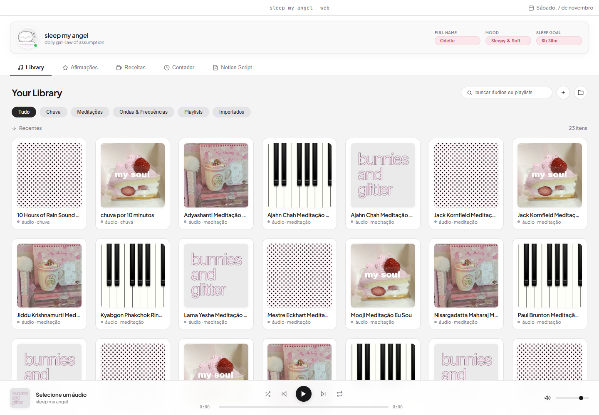

<div align="center">


# sleep my angel

**meu aplicativo de sono, frequências relaxantes, afirmações da lei da suposição e rituais da noite**


</div>

<br />

esse é um projeto que eu já estava rascunhando há um tempo e finalmente resolvi estruturar certinho pra me ajudar a dormir em paz. quem tem insônia ou a cabeça cheia antes de deitar sabe como é difícil desacelerar, então quis criar um app bem bonitinho e confortável só meu pra ter tudo que preciso em um lugar só.

a ideia central do **sleep my angel** é juntar sons de chuva, ruídos relaxantes e meditações funcionando em segundo plano no celular ou computador, sem anúncios ou interrupções chatas, com um cantinho dedicado à lei da suposição (principalmente inspirada nas palestras e visões do Edward Art e Neville Goddard).

o app roda como **APK nativo para Android** (com projeto Capacitor e Gradle), como aplicativo de desktop em Electron e também tem uma **versão web** pra abrir no navegador e ver tudo maior.

<br />

<div align="center">
  
</div>

### o que tem no app

- **ícone oficial & foto customizável**: o ícone do APK no seu celular é a arte oficial da pastinha `assets/icon/`, e dentro do app você pode tocar na foto de perfil para escolher qualquer foto da sua galeria.
- **library estilo spotify (clean & cinza)**: grade com estética suave em tons de cinza e pastéis para navegar pelos áudios de chuva, meditações e frequências sonoras (ondas theta, pink noise e ruídos suaves). dá pra criar playlists por cor, escolher os sons de cada uma e buscar qualquer faixa.
- **áudio em 2º plano no android**: serviço em primeiro plano com notificação e wake lock para o som continuar tocando quando você apagar a tela ou trocar de app.
- **sons gerados na hora**: quando não existe nenhum arquivo local, o app cria chuva, pink noise, brown noise e theta wave pelo Web Audio, então nunca fica em silêncio.
- **cantinho da lei da suposição & edward art**: cartões de afirmações e lembretes de que a imaginação é a única realidade. conta também com leitura em voz alta em português pra ouvir deitada antes de adormecer com a sensação do desejo já consumado.
- **receitas de antes de dormir**: espaço dedicado pras minhas bebidinhas noturnas favoritas pra desacelerar o corpo (principalmente meu amado leite quente com mel e canela kkk, mas também moon milk de camomila e chá relaxante).
- **contador & sleep timer suave**: timer programável (15m, 30m, 45m, 1h, 1h30, 2h) que vai reduzindo o volume nos últimos sessenta segundos e desliga o som sem susto.
- **notion script offline**: editor de texto para guardar e lapidar os scripts de manifestação e rotina noturna sem precisar de internet, com download em `.md`.
- **estética retro mello**: janelinha com jeitinho de sistema antigo, perfil fofo, pílulas suaves e controles delicados.

<br />

<div align="center">
  
</div>

<br />

<div align="center">
  
</div>

### como baixar e instalar o APK no celular

1. vá na aba de [**Releases**](https://github.com/sorodeleite/sleep-my-angel/releases) deste repositório.
2. baixe o arquivo `sleep-my-angel.apk`.
3. abra o arquivo no seu celular Android e confirme a instalação (se pedir, autorize a instalação de fontes desconhecidas).
4. prontinho! o app vai aparecer na sua tela inicial.

<br />

### como rodar pelo computador

precisa de **Node.js 22 ou mais novo**. pro APK, também de **JDK 21** e do Android SDK.

1. baixe ou clone o repositório:
```bash
git clone https://github.com/sorodeleite/sleep-my-angel.git
cd "sleep my angel"
```
2. instale as dependências:
```bash
npm install
```
3. rode o app de desktop:
```bash
npm start
```
4. pra abrir a versão web no navegador:
```bash
npm run web
```
ela sobe em `http://127.0.0.1:4173` e usa os áudios da pasta `audios/` quando eles existem. sem os arquivos, a biblioteca cai nos sons gerados e nas demonstrações.

### como gerar o APK

```bash
npm run cap:sync
cd android
./gradlew assembleDebug
```

no windows pode ser `gradlew.bat assembleDebug`. o `.apk` gerado fica em `android/app/build/outputs/apk/debug/app-debug.apk`.

o workflow de `Build Android APK` também gera o APK e publica na aba de releases a cada push na `main`.

<br />

### estrutura

```
audios/        minhas faixas locais (não vão pro git)
assets/        ícone, fotos e imagens do readme
js/            módulos do app (player, library, timer, notas...)
scripts/       build da versão web e servidor local
android/       projeto nativo em Capacitor
index.html     shell compartilhado entre desktop, android e web
main.js        processo principal do Electron
preload.js     ponte segura do Electron
```

<br />

<div align="center">
  
  <br /><br />
  
  <br /><br />
  <sub>projeto pessoal em andamento ‧ feito com carinho para noites tranquilas ‧°</sub>
</div>
